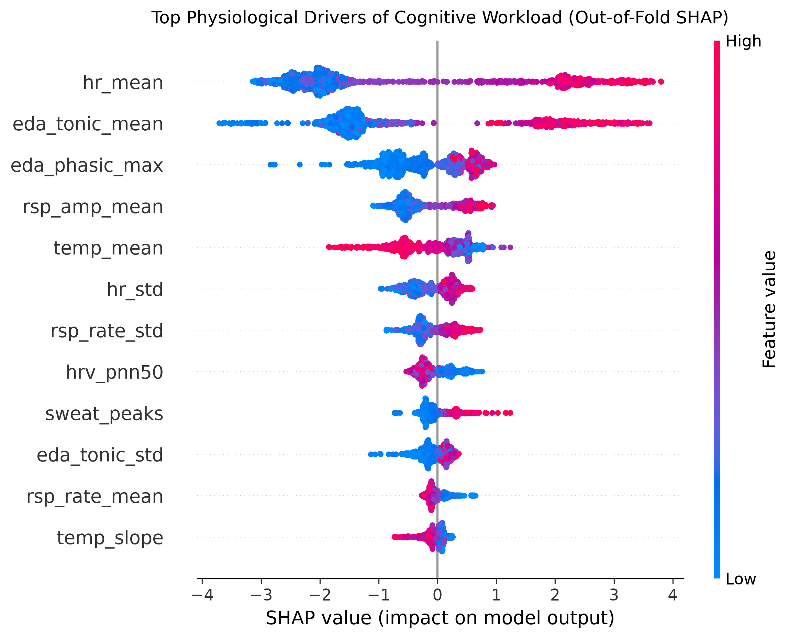
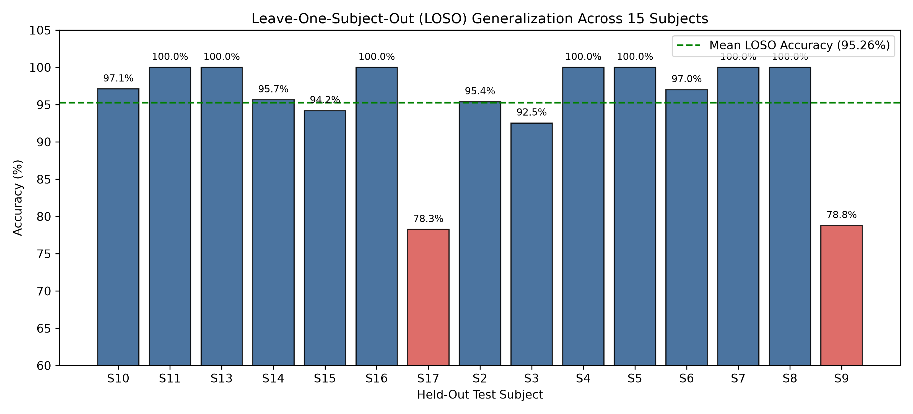

# Multimodal Cognitive Workload Estimation from Wearable Physiological Signals

An end-to-end multimodal signal processing and machine learning pipeline for estimating human cognitive workload and acute stress from synchronized cardiac (ECG), electrodermal (EDA), respiratory, and peripheral temperature signals on the **WESAD** benchmark dataset.

## Key Highlights
- **Modality-Specific Signal Processing:** Bandpass filtering, R-peak detection, time/frequency-domain HRV (`RMSSD`, `SDNN`, `pNN50`, `LF/HF`), tonic-phasic skin conductance decomposition (`SCL`/`SCR`), and respiratory rate/amplitude extraction via `NeuroKit2`.
- **Subject-Independent Evaluation:** Strict **Leave-One-Subject-Out (LOSO)** cross-validation across all 15 subjects with per-subject Z-score normalization to prevent data leakage and account for baseline physiological differences.
- **Multimodal Synergy:** Combining all 18 multimodal features achieves **95.27% Binary Accuracy (91.95% F1)** and **82.17% 3-Class Accuracy (72.10% Macro F1)**, outperforming single-modality baselines by **+5.42% Binary F1**.

## Multimodal Ablation Results (LOSO Cross-Validation)

| Modality Setup | Features | Binary Acc (%) | Binary F1 (%) | 3-Class Acc (%) | 3-Class Macro F1 (%) |
| :--- | :---: | :---: | :---: | :---: | :---: |
| Cardiac Only (ECG) | 8 | 92.12 | 86.53 | 79.11 | 69.35 |
| Electrodermal Only (EDA) | 5 | 89.16 | 81.48 | 73.69 | 58.42 |
| Respiration & Skin Temp | 5 | 86.31 | 76.72 | 77.04 | 64.88 |
| Wearable Wrist Only (EDA + Temp) | 7 | 88.57 | 79.72 | 75.57 | 68.37 |
| **Full Multimodal Fusion** | **18** | **95.27** | **91.95** | **82.17** | **72.10** |

## Explainability & Cross-Subject Generalization
- **Out-of-Fold SHAP Analysis:** Identifies autonomic nervous system markers driving high cognitive workload predictions.
- **Error Analysis:** 13/15 subjects exceed 92.5% accuracy (7 reaching 100%), while outlier subjects (`S9`, `S17` at ~78.5%) highlight inter-subject physiological variability.

